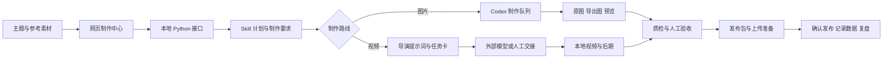

# 抖音 AI 内容创作工作台

一个本地运行的图片与视频创作管理工作台，面向“提出主题 → 编排 Skills → 制作 → 质检 → 验收 → 发布准备 → 复盘”的完整过程。支持不同账号和内容项目，制作要求、素材、任务状态与交付文件都保存在自己的电脑中。

**项目处于可用性迭代阶段。** 网页能组织和执行本地任务；需要理解内容和审美的制作步骤由 Codex 执行，视频镜头由已配置的外部服务生成。安装本仓库不会自动获得 Codex、视频平台订阅、第三方 Skill 或平台上传能力。

## 能做什么

| 模块 | 当前行为 |
| --- | --- |
| 统一制作中心 | 创建图片或视频项目，选择账号，填写要求，草稿自动保存、冲突提示 |
| 素材库 | 导入图片、视频和音频，标明参考用途、保留项、修改项与外部上传许可 |
| Skill 编排 | 根据内容路线与意图生成 Skill 计划，列出缺失项与执行顺序 |
| 图片制作 | 生成计划进入 Codex 队列，由 Codex 领取、生成并回传本地文件 |
| 视频任务卡 | 将导演提示词编译为 Flova、即梦/Seedance 或 MiniMax H3 任务确认卡 |
| Flova 执行 | 官方 CLI 适配、状态、用户选择、原任务恢复、导出与本地媒体检查；平台生命周期已模拟验证，真实模型闭环仍待验证 |
| 后期与质检 | 连接 FFmpeg 探测与发布包检查；Remotion、配音等能力按安装情况启用 |
| 发布准备 | 生成发布包和 prepare-only 计划；social-auto-upload 当前输出命令预览，网页不直接代发 |
| 数据复盘 | 保存快照并生成指标摘要；监控需要另外配置，本仓库不自动开启定时采集 |

图片流程在维护者环境完成过一次真实单图生成与回传。该结果不代表每个使用者安装后都已配置好相应模型或 Codex 工具。

## 60 秒启动

基础网页只依赖 **Python 3.11 或更高版本**，无需 Node、GPU、模型或 API Key。已在 Windows / Python 3.12 验证核心流程。核心 Python 入口采用跨平台路径；macOS/Linux 尚未完成实际系统验收，Windows PowerShell 启动器与历史视频脚本有各自适用范围。

克隆到任意可写目录，盘符、中文目录和空格都不作为部署限制：

```sh
git clone https://github.com/BA-Barry/douyin-ai-content-workbench.git
cd douyin-ai-content-workbench
python manage.py init
python manage.py serve
```

打开 http://127.0.0.1:8765/ 。在 macOS/Linux 上，如果 Python 命令为 `python3`，替换上述命令即可。服务默认仅监听本机回环地址，按 Ctrl+C 停止。

`init` 只创建缺失的本地文件，重复执行不会覆盖账号、草稿或已有内容。首次使用显示的是通用演示账号和空项目列表，可在网页创建自己的账号档案与项目。

Windows 也可以双击 `workbench/打开工作台.cmd`：它会检查本机端口，复用同一项目的服务，或启动后台服务并打开网页。前台启动、端口修改、虚拟环境和停止方法见 [安装指南](docs/INSTALLATION.md)。

## 工作原理



网页负责保存、调度、进度和预览；Skill 是 Codex 读取的规则与方法；生成工具才负责产出媒体。保存制作要求、生成确认卡、拿到真实文件、用户验收是不同步骤。工作台不会用计划状态代替生成进度。

图片与视频共用制作中心和素材库，但项目创建后路线固定。视频需要稳定人物、场景、首尾帧时才追加图片锚点子任务；纯文生视频不强制先生成图片。详见 [制作流程](docs/WORKFLOWS.md) 和 [架构与数据](docs/ARCHITECTURE.md)。

## 第一次如何使用

1. 启动后创建本地账号档案，填写受众、定位和内容形式。这里切换的是本地运营档案，平台登录仍在浏览器中完成。
2. 在制作中心新建项目，选择图片或视频，填写主题、观众收益、风格、图数或时长、画幅、人物、文字和声音要求。
3. 可选导入素材，标明它用于构图、风格、角色、场景还是运镜；说明哪些可以保留、哪些应当变化。
4. 保存制作要求，查看 Skill 计划。若显示缺失 Skill，先按 [Skill 配置](docs/SKILLS_AND_PROVIDERS.md) 安装需要的能力。
5. 在 Codex 中打开项目，按队列和项目 brief 执行制作。视频先核对任务卡中的平台、模型、时长、清晰度、积分和引用素材，再决定提交。
6. 查看本地预览与 QA，接受最终版本后进入发布准备。发布和费用均保留明确确认点。

不使用 Codex 时仍可管理素材、项目、任务卡和文件，图像生成队列会等待执行方。

## 环境和可选依赖

默认路径从当前项目自动推导，环境与缓存默认位于该目录中。可以放在任意磁盘，不要求 项目目录，也不会查找原作者的用户目录。

| 配置项 | 用途 | 默认 |
| --- | --- | --- |
| `DOUYIN_PROJECT_ROOT` | 另一个完整工作副本的根目录 | 当前代码所在项目 |
| `DOUYIN_PYTHON` | 子任务使用的 Python | `.venv` → 旧 `envs/content` → 当前解释器 |
| `DOUYIN_SKILLS_DIR` | 本地 Skill 索引和管理目录 | `<项目>/skills` |
| `DOUYIN_CACHE_DIR` | 缓存与临时目录 | `<项目>/cache` |
| `DOUYIN_MODELS_DIR` | 模型缓存目录 | `<项目>/models` |
| `DOUYIN_FLOVA_CLI` | 官方 Flova CLI 路径 | 项目内安装 → PATH |
| `DOUYIN_FLOVA_SKILL_ID` | 自己账号可访问的 Flova 私有 Skill | 空，执行前需要配置 |
| `PROJECT_FFMPEG_EXE` / `PROJECT_FFPROBE_EXE` | 媒体检测工具路径 | 项目 tools 目录 → PATH |

图片 QA 和历史媒体脚本需要 Pillow、NumPy 等可选依赖；视频媒体检查需要 FFmpeg 与 ffprobe；Node/Remotion、DepthFlow、ElevenLabs、Flova 各有独立配置。基础启动不会下载模型或提交外部生成任务。详见安装指南。

## 目录结构

```text
manage.py             初始化、启动与配置诊断
config/               进程环境与可选依赖清单
workbench/            本地 HTTP 服务、前端、草稿、素材库、任务执行器
src/                  队列、视频编译、QA、发布包、指标与状态命令
skills/               本仓库包含的四个自有 Skill
workflow/             主控规则、三条内容路线、阶段模板与人工审核点
examples/             无真实账号和作品的初始化模板
tests/                单元、接口、前端及媒体探测测试
docs/                 部署、架构、制作、Skill 与排错文档
data/ content/        首次使用时创建的本地状态与作品文件（不提交）
cache/ models/       可重建缓存与可选模型（不提交）
workspace/ trash/    临时执行结果和可恢复移除的文件（不提交）
```

第三方 Skill 与参考项目按各自许可证另外安装。本仓库不分发原作者的私人 Flova Skill、浏览器会话、账号数据、研究评论和生成作品。现有风景账号定位和历史工具记录属于案例，使用者应修改为自己的内容方向。

## 验证与开发

```sh
python manage.py init
python manage.py doctor
python -m unittest discover -s tests -p "test_*.py"
node tests/test_workbench_frontend.cjs
node tests/test_persistent_drafts.cjs
node tests/test_studio_safety.cjs
```

Node 仅用于前端测试或可选视频后期。没有安装 FFmpeg 时，依赖真实媒体探测的集成测试会标明跳过；纯本地流程与模拟平台测试不要求付费账号。所有测试使用合成夹具和临时目录。

生产审计命令是 `python src/workflow_control.py audit`。新仓库没有真实研究与审批时会返回 `BLOCKED`；这与程序安装成功是两件事。不能伪造样本以获得审计通过。

## 文档导航与后续范围

- [安装、配置和迁移](docs/INSTALLATION.md)
- [图片与视频制作流程](docs/WORKFLOWS.md)
- [架构、任务状态和数据目录](docs/ARCHITECTURE.md)
- [Skills、模型与服务商配置](docs/SKILLS_AND_PROVIDERS.md)
- [常见问题与能力边界](docs/TROUBLESHOOTING.md)
- [主控工作流](workflow/MASTER_WORKFLOW.md)
- [贡献说明](CONTRIBUTING.md)

接下来优先验证一次经授权的视频真实生成、恢复与下载闭环，完善 Skill 安装体验与发布页交接，并在实际 macOS/Linux 环境进行验收。欢迎通过 Issue 提交复现步骤、环境版本和经过脱敏的错误信息。
